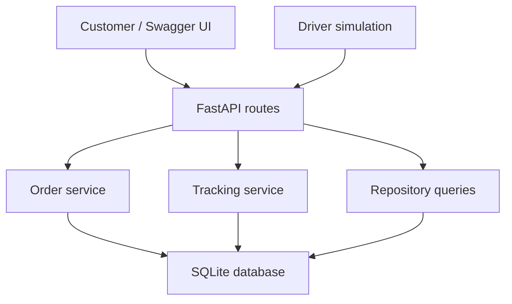

# Design: Track C Live Order Tracking

## Components

- `src/routes`: validation of HTTP request payloads and response contracts.
- `src/services/orders.py`: order totals, menu ownership and atomic creation.
- `src/services/tracking.py`: status transition graph, ETA calculation and timestamped history.
- `src/repositories/store.py`: query-only SQLite access.
- `src/database.py`: schema, connection factory, and seed data.
- `scripts/simulate_driver.py`: API-driven demonstration.
- `tests/`: isolated temporary SQLite databases.

## Interfaces and data changes

`PATCH /orders/{id}/status` accepts `{"status":"PREPARING"}` and rejects invalid transitions with HTTP 409. `GET /orders/{id}/tracking` supplies `order_id`, `status`, `estimated_arrival_at` and `history`. The baseline `orders` table gains nullable `eta_at`. The new `order_status_history` table holds `id`, `order_id`, `status` and UTC `changed_at` values.

## ADR-001: Polling instead of server-sent events

**Decision:** Use polling via an ordinary GET endpoint.

**Alternatives:** (a) polling; (b) server-sent events; (c) WebSockets.

**Trade-offs:** Polling is easier to test, debug, and run with minimal dependencies but is less efficient than event streaming when many clients poll frequently. SSE sends updates automatically but increases connection-management complexity. WebSockets are bidirectional, which is unnecessary for a read-only customer view. Polling meets the assignment requirement with the smallest testable design.

## ETA simplification

No coordinates exist in the baseline, so distance is modeled as a fixed 12-minute drive, documented rather than misleadingly presented as GPS-based. Initial ETA = now + restaurant average prep time + 12 minutes. PREPARING uses half remaining prep time plus 12; READY and PICKED_UP use 12; DELIVERED uses now; CANCELLED has no ETA. Recalculation uses a timestamp parameter in the service layer so tests can inject a fixed clock.
